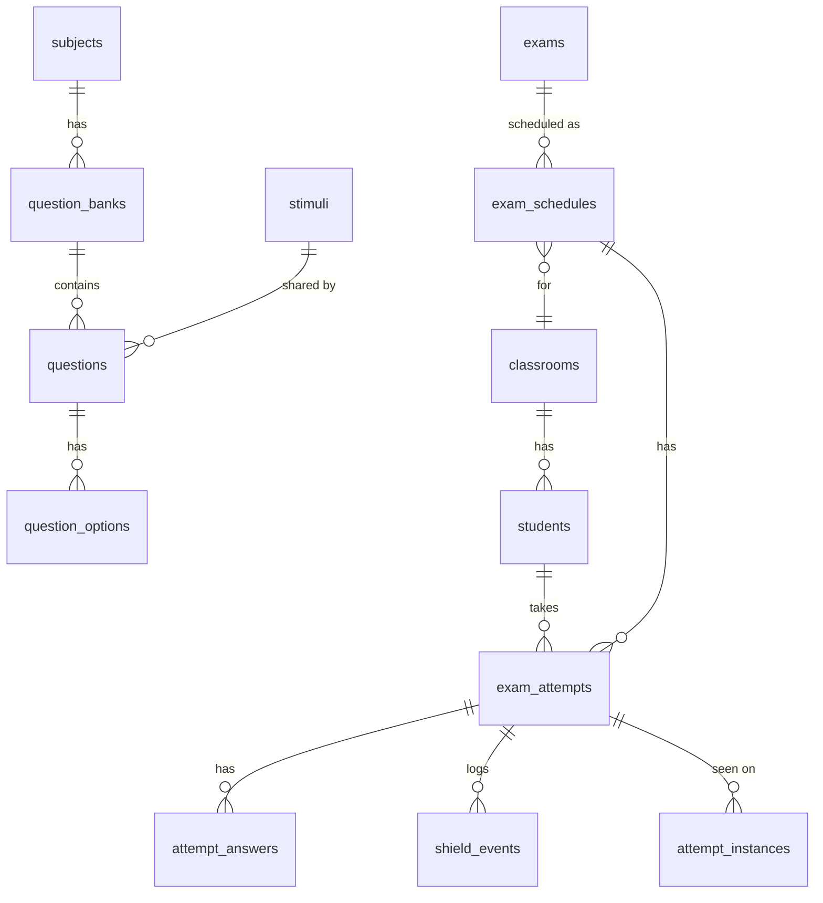

<p align="center"></p>

# 📘 KITAQ ONLINE — KITA Assessment & Question
### Sistem Ujian Online Anti-Contek · Produk **CiptaKita.id** — *Solusi Digitalmu, dari kita!*

> Dokumen induk untuk AI agent (Claude Code / Copilot / Cursor) di VS Code.
> KITAQ ONLINE adalah **aplikasi terpisah** dari KITAQ (offline). Fitur akademiknya sama; bedanya: berjalan **online di hosting**, siswa login dengan **NISN + tanggal lahir**, dan anti-contek diperkuat untuk HP (split screen, terjemahan otomatis, ekstensi AI, keyboard AI).

---

## 0. INSTRUKSI UNTUK AI AGENT (WAJIB DIBACA DULU)

1. Baca dokumen ini sampai habis, lalu `docs/ANTI_CONTEK.md`, `docs/DESIGN_SYSTEM.md`, `docs/DEPLOY_SHARED_HOSTING.md`, `docs/KEAMANAN.md`, `config/kitaq.php`.
2. Buka prototipe `design/admin-prototype.html` dan `design/exam-mobile-prototype.html` di browser sebagai acuan tampilan.
3. **Kode referensi sudah ada dan wajib dipakai/diadaptasi, bukan ditulis ulang dari nol:**
   - `resources/js/shield/**` — KITAQ Shield (anti-contek di browser)
   - `resources/js/keyboard/**` — Keyboard Virtual KITAQ
   - `resources/js/exam/**` — klien ruang ujian & sinkronisasi jawaban
   - `resources/views/layouts/exam.blade.php`, `resources/css/exam.css`
   - `app/Services/Shield/*`, `app/Services/Auth/StudentCredential.php`, `app/Services/ExamTokenService.php`, `app/Http/Middleware/SecurityHeaders.php`
   - `tests/Unit/*` (test harus tetap lulus)
4. **Laravel 12, `"php": "^8.2"`.** Dilarang memakai sintaks/fitur PHP 8.3+ (typed class constants, `#[\Override]`, `json_validate()`, dll).
5. **Target hosting: shared/cloud hosting.** Tidak ada WebSocket, Redis, Supervisor, atau Node.js di server. Realtime memakai **polling HTTP**. Proses latar memakai **cron → `schedule:run`**. Aset dibangun di laptop (`npm run build`) lalu diunggah.
6. **Dilarang memasang Filament** atau paket panel admin jadi. Dashboard admin dibuat sendiri (Blade + Livewire 3 + Alpine + Tailwind v4) mengikuti design system.
7. **Halaman ujian siswa tanpa Livewire, tanpa `<input>`/`<textarea>`/contenteditable, tanpa skrip pihak ketiga.** Lihat Bagian 5.7 dan 5.9.
8. Semua teks antarmuka **Bahasa Indonesia**; kode, nama tabel & variabel **Bahasa Inggris**.
9. Kerjakan **per fase** (Bagian 14). Di akhir setiap fase: jalankan `php artisan test`, centang checklist, catat keputusan di `docs/DECISIONS.md`.
10. **Kunci jawaban tidak pernah dikirim ke browser siswa.** Penilaian di server.
11. Bila ragu, pilih opsi yang lebih aman untuk integritas ujian, lalu catat alasannya.

---

## 1. RINGKASAN APLIKASI

KITAQ ONLINE adalah aplikasi CBT berbasis web yang di-hosting di internet (mis. `ujian.sekolah.sch.id`). Siswa membuka lewat browser HP (Android, iPhone/iPad, Huawei HarmonyOS) atau laptop, login dengan **NISN** dan **tanggal lahir**, lalu mengerjakan ujian sesuai jadwal kelasnya. Pengawas memantau semua siswa dari dashboard, menerima alarm saat ada pelanggaran, dan membuka kunci ujian bila perlu.

### Perbedaan dengan KITAQ (offline)

| Aspek | KITAQ (offline) | **KITAQ ONLINE** |
|---|---|---|
| Server | Laptop sekolah (XAMPP) | **Shared/cloud hosting** + domain + HTTPS |
| Jaringan siswa | WiFi lokal tanpa internet | **Internet biasa** (paket data/WiFi apa pun) |
| Login siswa | NIS/username + password | **NISN + tanggal lahir (DDMMYYYY)** + token ujian |
| Probe internet (cek paket data tiap beberapa detik) | Ada, mengunci ujian | **Dihapus** — internet memang dibutuhkan |
| Putus jaringan | Mengunci ujian | **Tidak mengunci**; jawaban disimpan di HP, dikirim saat online lagi |
| Realtime | WebSocket (Reverb) | **Polling HTTP** (cocok shared hosting) |
| Mode LAN/Hotspot, pra-cek jaringan, skrip Windows | Ada | **Dihapus** |
| Anti-contek | Tab, fullscreen, split screen dasar | **KITAQ Shield**: + split screen/jendela mengambang presisi, multi-tab & dua perangkat, terjemahan otomatis, ekstensi/asisten AI, **Keyboard Virtual KITAQ** (keyboard HP & keyboard AI tidak bisa muncul), Mode Soal Kanvas, analitik kerja sama |
| PWA | Opsional (butuh HTTPS lokal) | **Penuh** (HTTPS dari hosting); wajib di iPhone |

### Alur besar
```
Admin/Guru  →  Bank soal  →  Ujian + jadwal per kelas  →  Token tampil di layar pengawas
Siswa  →  buka situs  →  login NISN + tgl lahir  →  dashboard (ujian hari ini)
       →  masukkan token  →  cek perangkat otomatis  →  "Saya Mengerti & Mulai" (layar penuh)
       →  kerjakan (jawaban isian via Keyboard KITAQ)  →  kumpulkan  →  nilai (jika diizinkan)
KITAQ Shield  →  lapor event  →  server memutuskan (catat / peringatan / kunci)
Pengawas  →  monitoring (polling 4 dtk)  →  alarm  →  buka kunci / tambah waktu / kumpulkan paksa
```

---

## 2. STACK TEKNOLOGI

| Lapisan | Pilihan | Catatan |
|---|---|---|
| Framework | **Laravel 12** (`laravel/framework:^12.0`) | Sesuai keputusan pemilik. Perbaikan keamanan Laravel 12 sampai 24 Feb 2027 → rencanakan naik ke Laravel 13 (PHP 8.3+) sebelum itu (lihat `docs/DECISIONS.md`). |
| PHP | **8.2 minimum** (jalan di 8.2–8.4) | Di hosting, pilih PHP 8.3/8.4 bila tersedia; kode tetap kompatibel 8.2. |
| Database | MySQL 8 / MariaDB 10.6+ dari panel hosting | Charset `utf8mb4`. |
| Session, cache, queue | **database** | Shared hosting tanpa Redis. |
| Proses latar | Cron tiap menit → `php artisan schedule:run`; scheduler menjalankan `queue:work --stop-when-empty --max-time=50` | Tanpa Supervisor. |
| Realtime | **Polling HTTP**: heartbeat siswa 15 dtk, monitoring pengawas 4 dtk | Driver `KITAQ_REALTIME=polling`. Abstraksi disiapkan agar bisa diganti Reverb bila pindah ke VPS. |
| Panel admin | **Dashboard custom**: Blade + Livewire 3 + Alpine.js + Tailwind v4, pustaka `x-ui.*` | Tanpa Filament. Acuan `docs/DESIGN_SYSTEM.md` + `design/admin-prototype.html`. |
| Halaman ujian siswa | **Blade + JavaScript murni** (`resources/js/exam`, `shield`, `keyboard`) | Ringan, CSP ketat, tanpa Livewire. |
| Grafik / ikon / editor soal | Chart.js, Lucide, TipTap, KaTeX — dibundel lokal lewat Vite | Tanpa CDN. |
| Hak akses | spatie/laravel-permission | |
| Excel / PDF | maatwebsite/excel (OpenSpout) / barryvdh/laravel-dompdf | Ekspor besar lewat queue. |
| Test | Pest | `tests/Unit` sudah ada. |
| Uji beban | k6 (`tests/load/k6-exam.js`) | Wajib sebelum ujian massal pertama. |

---

## 3. PERAN PENGGUNA

| Peran | Hak |
|---|---|
| **Super Admin** | Semua, termasuk pengaturan sekolah, pengguna, backup, profil keketatan default. |
| **Operator** | Data master, siswa, jadwal, cetak kartu login, reset login. |
| **Guru** | Bank soal mapel yang diampu, ujian miliknya, koreksi uraian, rekap nilai kelasnya. |
| **Pengawas** | Monitoring sesi yang ditugaskan, lihat/putar ulang token, buka kunci (wajib alasan), tambah waktu, kumpulkan paksa, berita acara. |
| **Siswa** | Login NISN + tanggal lahir, ujian sesuai jadwal kelas, lihat nilai bila diizinkan. |

---

## 4. ⚠️ KETERBATASAN TEKNIS (JUJUR & PENTING)

Aplikasi web berjalan di dalam browser, jadi ada hal yang **tidak bisa dicegah**, hanya **dideteksi** atau **dipersulit**:

1. **Tidak bisa memblokir tombol Home, menutup aplikasi, atau screenshot/rekam layar** dari halaman web. KITAQ mendeteksi saat siswa meninggalkan halaman, memasang watermark nama + NISN, dan mengambil soal satu per satu.
2. **HP kedua / buku / teman di sebelah tidak terdeteksi** oleh perangkat lunak. Tetap butuh pengawasan ruang (atau ujian di sekolah dengan pembatasan IP).
3. **Asisten AI berbasis tangkapan layar** (mis. lingkari-untuk-mencari, asisten sistem yang membaca layar) tidak bisa diblokir oleh web. Yang bisa: saat overlay itu dibuka, halaman ujian **kehilangan fokus** → tercatat sebagai pelanggaran.
4. **Split screen tidak bisa dicegah, tetapi terdeteksi dengan andal** karena halaman ujian tidak pernah membuka keyboard HP (viewport hanya berubah oleh split screen/jendela mengambang).
5. **iPhone tidak mendukung layar penuh untuk halaman web.** Penggantinya: siswa memasang KITAQ ONLINE ke Layar Utama dan membukanya dari ikon (mode aplikasi tanpa bilah alamat). iPad mendukung layar penuh.
6. **Ekstensi browser** terdeteksi bila menyuntikkan elemen ke halaman (umumnya begitu). Ekstensi yang sama sekali tidak menyentuh halaman tidak terlihat; untuk itu ada **daftar browser yang diizinkan** dan **Mode Soal Kanvas**.
7. **User-Agent bisa dipalsukan.** Gerbang browser adalah lapisan tambahan, bukan satu-satunya pengaman.
8. **Sinyal internet siswa bisa putus.** Karena itu putus koneksi **tidak** mengunci ujian (bisa diubah per ujian), dan jawaban disimpan sementara di HP.
9. **Shared hosting punya batas proses & CPU.** Wajib uji beban (Bagian 9.3) dan atur jadwal sesi bergiliran bila peserta banyak.
10. **Untuk penguncian tingkat sistem** (blokir notifikasi, tangkapan layar, overlay, split screen di level OS) perlu aplikasi native — lihat Bagian 16 (opsional).

---

## 5. FITUR LENGKAP

### 5.1 Login Siswa (NISN + tanggal lahir)
- [x] Form: **NISN** (10 digit, keyboard angka) + **tanggal lahir** sebagai password, format `DDMMYYYY` (contoh 20 Oktober 2008 → `20102008`). Petunjuk format tampil di bawah kolom.
- [x] Input password dirapikan otomatis: `20-10-2008`, `20/10/2008`, `2008-10-20` diterima (`StudentCredential::normalizePasswordInput`).
- [x] Password disimpan sebagai **hash bcrypt** dari `DDMMYYYY` saat import/input. Tanggal lahir asli disimpan di kolom terpisah (untuk reset) dan **disamarkan** di UI (`20-10-****`).
- [x] Opsi sekolah: **wajib ganti password saat login pertama** (default mati sesuai permintaan; bisa dinyalakan).
- [x] **Rate limit**: 5 percobaan/menit per NISN+IP; 10 gagal berturut → akun dibekukan 15 menit + tercatat di log; pengawas/operator bisa membuka.
- [x] **Token ujian** (6 karakter, berganti 15 menit, `ExamTokenService`) diminta saat **memulai/melanjutkan** ujian. Tujuannya: orang yang tahu NISN + tanggal lahir tetapi tidak berada di ruang ujian tidak bisa mulai.
- [x] **Satu sesi aktif**: login baru di perangkat lain menutup sesi lama bila tidak sedang ujian. Bila sedang ujian → ditolak dan pengawas mendapat notifikasi "login dari perangkat lain" (event `second_instance`), sampai pengawas klik **Reset Login**.
- [x] Gerbang browser saat login: browser tidak diizinkan / webview aplikasi (WhatsApp, Instagram, dll) → halaman petunjuk "Buka di Chrome/Safari/Samsung Internet/Huawei Browser" dengan tombol salin tautan.
- [x] Halaman **Cek Perangkat** (`/cek-perangkat`) bisa dibuka sebelum hari ujian (lihat `public/cek-perangkat.html`).

### 5.2 Data Master
- [x] Tahun ajaran & semester aktif, kelas/rombel, mapel + guru pengampu, ruang (opsional), sesi ujian.

### 5.3 Manajemen Siswa
- [x] Input satuan & **bulk Excel** (`templates/template_siswa.xlsx`, kolom Bagian 8.1).
- [x] Import membaca tanggal lahir dari berbagai format (serial Excel, `2008-10-20`, `20/10/2008`, `20 Oktober 2008`, dll — `StudentCredential::parseBirthDate`) dan memulihkan nol di depan NISN yang hilang di Excel.
- [x] Pratinjau, tandai baris galat (NISN tidak 10 digit, NISN ganda, tanggal tidak valid), mode lewati/perbarui, unduh laporan galat.
- [x] **Cetak kartu login** (PDF): nama, NISN, kelas, alamat situs + QR ke situs. Tanggal lahir **tidak dicetak** (siswa sudah tahu).
- [x] Reset password ke tanggal lahir, aktif/nonaktif, pindah kelas massal, foto (opsional, tampil di monitoring).
- [x] **Akomodasi** per siswa: tambahan waktu, ukuran huruf besar, nonaktifkan Mode Soal Kanvas (pengguna pembaca layar).

### 5.4 Pengguna (Admin/Guru/Pengawas)
- [x] Satuan & bulk (`template_pengguna.xlsx`), role, mapel ampu, log aktivitas. Login staf memakai email/username + password kuat; **2FA opsional** (TOTP) untuk Super Admin.

### 5.5 Bank Soal
Sama dengan KITAQ offline:
- [x] Tipe: **PG, PG Kompleks, Benar/Salah (multi-pernyataan), Menjodohkan, Isian Singkat, Uraian**.
- [x] Editor TipTap (lokal), KaTeX, gambar di soal/opsi/stimulus, stimulus bersama, bobot, tingkat kesukaran, level kognitif, pembahasan, audio dengan batas putar.
- [x] Import **Excel + ZIP gambar** (`template_soal.xlsx`, `contoh_gambar_soal.zip`); cegah zip-slip, optimasi gambar (WebP, maks 1600 px), sanitasi HTML.
- [x] Isian singkat: kunci boleh beberapa variasi; opsi "angka" → Keyboard KITAQ menampilkan papan angka.
- [x] **Paket soal A/B/C** dan acak soal/opsi per siswa.

### 5.6 Ujian & Jadwal
- [x] Ujian: nama, jenis, mapel, bank soal, jumlah soal (acak N dari bank), durasi, KKM.
- [x] **Jadwal per kelas/rombel** + sesi + jam buka/tutup. Siswa hanya melihat ujian kelasnya. Peserta khusus (susulan/remedial).
- [x] **Pengaturan ujian** (JSON `exams.settings`):
  - Acak soal / acak opsi
  - Wajib token (default ✅)
  - Tampilkan nilai: langsung / setelah ditutup / tidak
  - Minimal waktu sebelum boleh kumpul
  - **Profil keketatan KITAQ Shield**: `longgar` / `standar` (default) / `ketat` + pengecualian per event (lihat `ViolationPolicy::PRESETS`)
  - Batas peringatan (default 2 → pelanggaran ke-3 mengunci)
  - Browser yang diizinkan (default Chrome, Safari, Samsung Internet, Huawei Browser)
  - iPhone wajib mode aplikasi (Layar Utama) ✅/❌
  - Wajib layar penuh ✅/❌
  - Keyboard fisik: HP `blokir` / laptop `izinkan`
  - **Mode Soal Kanvas** ✅/❌ (ketat+)
  - Putus koneksi: `hanya catat` (default) / `kunci setelah N detik`
  - **Batasi lokasi**: hanya dari IP publik sekolah (daftar IP/CIDR) ✅/❌ — untuk ujian di sekolah yang wajib memakai WiFi sekolah
  - Waktu berjalan saat terkunci: tetap berjalan (default) / dijeda
- [x] Mulai/tutup **otomatis** (scheduler) dan **manual** (mulai, jeda semua, lanjutkan, perpanjang, tutup paksa).
- [x] Waktu habis → **auto-submit dari server** (job terjadwal), walau HP siswa mati.

### 5.7 Halaman Ujian Siswa
- [x] Dibangun dari `resources/views/layouts/exam.blade.php` + `resources/js/exam/exam-app.js`.
- [x] Halaman konfirmasi: identitas, aturan, **prapemeriksaan perangkat otomatis** (`shield.precheck()`): browser diizinkan, bukan split screen, iPhone dari Layar Utama. Tombol mulai nonaktif sampai lolos, alasan ditampilkan.
- [x] Tombol **"Saya Mengerti & Mulai"** → masuk layar penuh (Android/HarmonyOS/iPad/desktop) lalu guard aktif.
- [x] Soal diambil **satu per satu** dari API (prefetch 1 soal berikutnya boleh), dengan urutan acak per siswa dari server.
- [x] PG/PGK/BS/Jodoh dijawab dengan **ketukan** (tidak butuh keyboard). Isian & uraian lewat **Keyboard Virtual KITAQ** (5.9).
- [x] Autosave (`answer-sync.js`): status *Tersimpan / Menyimpan… / Offline — jawaban aman di HP*. Jawaban punya nomor revisi; server menolak revisi lama.
- [x] Timer dari **jam server** (dikoreksi setiap heartbeat). Ragu-ragu, peta soal, ukuran huruf.
- [x] Watermark nama + NISN (samar, diagonal).
- [x] **Tidak ada `confirm()`/`alert()`** (dialog bawaan memicu blur palsu) — semua konfirmasi memakai modal KITAQ.
- [x] Halaman hasil (jika diizinkan).

### 5.8 KITAQ Shield (anti-contek) — ringkasan
Detail lengkap, matriks platform, dan ambang di **`docs/ANTI_CONTEK.md`**. Kode di `resources/js/shield`.

| Ancaman siswa | Penangkal KITAQ ONLINE |
|---|---|
| Pindah aplikasi/tab | `focus-guard` (visibilitychange, blur, pagehide, polling `hasFocus`) |
| **Split screen / jendela mengambang / Slide Over iPad** | `window-guard` (rasio viewport vs layar; andal karena keyboard HP tidak pernah muncul) + penutup layar |
| **Double window / dua tab / dua browser / dua HP** | `tab-guard` (BroadcastChannel + kunci localStorage) + server: dua `instance_id` aktif pada satu percobaan → `second_instance` |
| **Terjemahan otomatis Chrome/Edge/Safari** | Pencegahan `translate="no"` + meta `notranslate`; deteksi kelas `translated-*`, `<font>`, atribut Microsoft Translator, dan **sidik jari (hash) teks soal** |
| **Ekstensi / add-on AI** | `extension-guard` (tanda tangan ekstensi AI yang dikenal, elemen/iframe/style asing, sumber `*-extension://`) + daftar browser yang diizinkan (Edge/Opera/Brave dengan asisten AI bawaan diblokir default) + Mode Soal Kanvas |
| **Keyboard AI di HP** (saran/tulis-ulang AI, dikte, papan klip) | **Keyboard Virtual KITAQ** — halaman ujian tanpa field teks, jadi keyboard HP tidak pernah terbuka; `input-guard` melepas fokus field asing |
| Seleksi teks → menu Terjemahkan/Telusuri/Tanya AI | Seleksi & menu tekan-lama dimatikan |
| Salin/tempel, klik kanan, pintasan, PrintScreen | `input-guard` |
| Keyboard Bluetooth di HP | `input-guard` → `physical_keyboard` |
| Mematikan internet untuk menyembunyikan pelanggaran | Event disimpan di HP dengan waktu asli dan dikirim saat online lagi; heartbeat hilang dicatat server |
| Mengubah/mematikan JavaScript | Heartbeat berisi nonce dari server; heartbeat berhenti → `heartbeat_gap`; keputusan & penilaian tetap di server |
| Joki dari rumah | Token ujian di ruang + (opsional) batasan IP sekolah + satu sesi aktif + foto di monitoring |
| Kerja sama/bertukar jawaban lewat chat | **Analitik kerja sama** setelah ujian (5.11) |

### 5.9 Keyboard Virtual KITAQ
- [x] Kode: `resources/js/keyboard/kitaq-keyboard.js` (+ `.css`). Sudah jalan; integrasikan ke soal isian/uraian.
- [x] Kotak jawaban = `<div role="textbox">` tanpa `contenteditable`, kursor digambar sendiri, ketuk teks untuk memindah kursor.
- [x] Tata letak: huruf QWERTY (⇧ sekali / dua kali = Caps), angka & tanda baca, simbol & matematika (√ π ² ³ ± × ÷ ≤ ≥ ≠ ½ °), **papan angka** untuk isian angka.
- [x] ⌫ tekan lama = hapus cepat; ‹ › geser kursor; ↵ hanya untuk uraian; tombol **Selesai** menutup keyboard.
- [x] Tanpa koreksi otomatis, prediksi, tempel, dikte. Getar halus di Android (iOS tidak mendukung getar web).
- [x] Laptop: bila ujian mengizinkan keyboard fisik di desktop, ketikan diteruskan ke kotak jawaban (`handleDesktopKey`); pintasan tetap diblokir.
- [x] Batas karakter: isian 120, uraian 3.000 (bisa diatur per soal), penghitung karakter tampil.
- [x] Aksesibilitas: tombol punya `aria-label`; kotak jawaban punya `aria-label` berisi jawaban.

### 5.10 Monitoring Live (pengawas)
- [x] Polling `GET /api/monitor/{schedule}` tiap 4 dtk (respons di-cache 2 dtk di server, payload ringkas).
- [x] Kartu siswa: status (belum masuk/mengerjakan/peringatan/terkunci/terputus/selesai), progres, pelanggaran, **perangkat** (OS + browser + mode aplikasi), IP, terakhir terlihat.
- [x] Feed pelanggaran dengan jenis baru: *split screen*, *terjemahan*, *ekstensi AI*, *dua perangkat*, *keyboard fisik*, *heartbeat hilang*.
- [x] **Panel Token**: token aktif besar + hitung mundur ganti + tombol layar proyektor.
- [x] Aksi: buka kunci (wajib alasan), reset login, tambah waktu, kumpulkan paksa, kirim pesan ke siswa (muncul sebagai toast), lihat log & linimasa perangkat.
- [x] Alarm suara + notifikasi browser (izin diminta sekali) + judul tab berkedip saat ada siswa terkunci.

### 5.11 Rekap, Laporan & Analitik Integritas
- [x] Rekap nilai, ekspor Excel/PDF, format e-Rapor, analisis butir (kesukaran, daya beda, pengecoh), koreksi uraian, berita acara, daftar hadir — sama dengan KITAQ offline.
- [x] **Rekap pelanggaran** per siswa/ujian/jenis + grafik per jam.
- [x] **Analitik kerja sama** (job setelah ujian ditutup): pasangan siswa dengan **jawaban salah identik** jauh di atas wajar, urutan menjawab mirip, dan waktu menjawab berdekatan → daftar "perlu ditinjau" (bukan vonis otomatis).
- [x] **Analitik kecepatan**: jawaban benar dalam waktu sangat singkat untuk soal panjang → ditandai untuk ditinjau.
- [x] **Satu perangkat, banyak akun**: sidik perangkat sama dipakai beberapa NISN pada sesi yang sama → indikasi joki.

### 5.12 Dashboard
- [x] **Admin**: siswa aktif, ujian hari ini, siswa online, pelanggaran hari ini, beban server (respons rata-rata API, antrean), grafik nilai per mapel.
- [x] **Siswa**: ujian hari ini (tombol mulai aktif hanya pada jam ujian), jadwal mendatang, riwayat & nilai (jika diizinkan), panduan pasang ke Layar Utama (iPhone), tautan Cek Perangkat.

### 5.13 Sistem
- [x] Pengaturan sekolah (nama, logo, kop, kepala sekolah).
- [x] Backup database harian (mysqldump bila tersedia, atau ekspor Laravel per tabel) ke storage + unduh; retensi 14 hari.
- [x] Log aktivitas (siapa membuka kunci, mengubah nilai, mereset login).
- [x] Halaman status kesehatan (`/admin/kesehatan`): cron terakhir jalan, antrean, ukuran database, versi PHP, waktu respons.

---

## 6. DESAIN DATABASE



| Tabel | Kolom penting |
|---|---|
| `students` | id, classroom_id, **nisn (unik, char 10)**, nis?, name, gender, **birth_date (date)**, password (hash DDMMYYYY), must_change_password, photo?, is_active, failed_logins, locked_until, accommodations (json), last_login_at |
| `exam_schedules` | id, exam_id, classroom_id, room_id?, session_id?, date, opens_at, closes_at, status, **token_key** (acak, untuk ExamTokenService), token_required, ip_allowlist (json) |
| `exam_attempts` | id, exam_schedule_id, student_id, status (not_started/in_progress/warned/locked/submitted/force_submitted), **shield_status, warning_count, last_incident_at, lock_reason**, question_order (json), option_order (json), started_at, deadline_at, submitted_at, extra_minutes, **active_instance_id**, last_heartbeat_at, last_event_seq, ip_address, user_agent, device_info (json), score, score_detail (json) |
| `attempt_instances` | id, exam_attempt_id, instance_id, os, browser, device, standalone, ip, first_seen_at, last_seen_at |
| `attempt_answers` | id, exam_attempt_id, question_id, answer (json), rev, is_doubtful, is_correct?, score?, answered_at — unik (attempt, question) |
| `shield_events` | id, exam_attempt_id, seq, type, action (ignore/log/warn/lock), merged (bool), detail (json), client_at, received_at — unik (attempt, seq) |
| `unlock_logs` | id, exam_attempt_id, user_id, reason, reset_warnings, created_at |
| `integrity_flags` | id, exam_schedule_id, kind (identical_wrong/speed/shared_device), student_ids (json), score, detail (json), reviewed_by?, verdict? |
| tabel lain | sama dengan KITAQ offline: users, academic_years, classrooms, subjects, subject_user, rooms, exam_sessions, question_banks, stimuli, questions (answer_key **tidak pernah dikirim ke siswa**), question_options, exams (settings json), exam_schedule_student, activity_logs, settings |

Indeks wajib: `exam_attempts(exam_schedule_id, status)`, `exam_attempts(last_heartbeat_at)`, `shield_events(exam_attempt_id, received_at)`, `students(nisn)`.

---

## 7. API UJIAN & LOGIKA SERVER

Semua rute siswa: middleware `auth:student`, `security.headers:exam`, `throttle`, dan pengecekan kepemilikan attempt. Respons JSON ringkas (shared hosting).

| Metode & rute | Isi | Balasan |
|---|---|---|
| `POST /ujian/{schedule}/mulai` | `token` | redirect ke ruang ujian; buat/lanjutkan attempt; catat instance |
| `GET /api/attempts/{a}/questions/{no}` | — | soal ke-`no` sesuai urutan acak siswa: `id, no, type, text, stimulus, image, options[{key,label,text,image}], numeric, answer, flagged` (**tanpa kunci**) · 423 bila terkunci |
| `GET /api/attempts/{a}/map` | — | `items[{no, answered, flagged}]` |
| `POST /api/attempts/{a}/answers` | `answers[{question_id, answer, flagged, rev}]` | `saved[{question_id, rev}]` · 423 bila terkunci/habis waktu |
| `POST /api/attempts/{a}/events` | `instance_id, client_now, events[{seq,type,at,detail}]` | `acked[seq]`, `state` |
| `POST /api/attempts/{a}/heartbeat` | `instance_id, nonce, visible, focused, fullscreen, vw, vh, sw, sh, online, blockers[], pending_events` | `state{status, warnings, max_warnings, remaining_sec, reason_text, new_warning}`, `commands[]`, `nonce`, `next_in_sec` |
| `POST /api/attempts/{a}/submit` | — | `redirect` |
| `GET /api/monitor/{schedule}` (pengawas) | `since` | ringkasan kartu + event baru + token aktif |
| `POST /api/monitor/attempts/{a}/{aksi}` | unlock (alasan), reset-login, extend, force-submit, message | status baru |

### 7.1 Memproses event (`ShieldEventController` → `ShieldService`)
1. Tolak bila `instance_id` bukan instance aktif attempt → catat `second_instance` (lihat 7.2).
2. Abaikan `seq` yang sudah ada (unik `attempt_id, seq`) — idempoten, aman diulang.
3. Waktu kejadian = `client_at` **dijepit** ke rentang `[started_at, now]` (jam HP tidak dipercaya, tapi urutan & jarak antar-event tetap dipakai untuk jendela gabung).
4. Urutkan per `seq`, evaluasi dengan `ViolationPolicy::fromPreset($exam->preset, $exam->overrides, $exam->max_warnings)` dalam **transaksi + `lockForUpdate()`** pada attempt.
5. Simpan `shield_events` (action, merged), perbarui kolom shield di attempt.
6. Bila `locked` baru → tulis notifikasi untuk pengawas (tabel `monitor_alerts`, diambil lewat polling).
7. Balas `state` terbaru.

### 7.2 Satu sesi aktif (dua jendela / dua perangkat)
- `instance_id` dibuat per tab (sessionStorage). Saat mulai, server menyimpan `active_instance_id`.
- Heartbeat/event dari `instance_id` lain pada attempt yang sama → event `second_instance` (default **kunci**) dan instance baru menerima `state.status = blocked_instance`.
- Pengawas **Reset Login** → `active_instance_id` dikosongkan; perangkat berikutnya yang mulai (dengan token) menjadi aktif.

### 7.3 Heartbeat & putus koneksi
- Heartbeat 15 dtk (+ jitter). Server menyimpan `last_heartbeat_at` dan instance.
- Job terjadwal tiap menit: attempt `in_progress` tanpa heartbeat > `heartbeat_gap_sec` (60) → event `heartbeat_gap` (log) + status kartu **terputus** di monitoring. Tidak mengunci kecuali `offline_lock_after_sec > 0`.
- Nonce bergulir: server mengirim nonce baru tiap balasan; heartbeat tanpa nonce yang benar dicatat (`heartbeat_invalid`) — menandai klien yang dimodifikasi.

### 7.4 Waktu & penilaian
- `deadline_at = started_at + durasi + extra_minutes` (dibatasi `closes_at` jadwal). Job tiap menit mengumpulkan otomatis attempt yang lewat batas.
- Penilaian otomatis saat submit (PG, PGK, BS, jodoh, isian), uraian menunggu guru. Nilai dihitung ulang setelah koreksi.

### 7.5 Keamanan data soal
- Kunci jawaban tidak pernah keluar dari server; opsi diacak per siswa dan dikirim dengan kunci acak (`key`) yang dipetakan di server.
- Gambar soal disajikan lewat rute bertanda tangan (`URL::temporarySignedRoute`, 30 menit) hanya untuk attempt aktif — tidak ada folder publik berisi semua gambar soal.
- Respons soal `Cache-Control: no-store`.

---

## 8. FORMAT IMPORT (TEMPLATE EXCEL)

### 8.1 Siswa — `templates/template_siswa.xlsx`
| Kolom | Wajib | Contoh | Catatan |
|---|---|---|---|
| `nisn` | ✅ | `0081234567` | 10 digit. Format kolom **Teks** agar nol di depan tidak hilang (import tetap memulihkan). |
| `nama` | ✅ | Aisyah Putri Rahayu | |
| `tanggal_lahir` | ✅ | `20/10/2008` | Menjadi password `20102008`. Diterima juga `2008-10-20`, `20 Oktober 2008`, sel bertipe Tanggal. |
| `jenis_kelamin` | ✅ | L / P | |
| `kelas` | ✅ | XII IPS 1 | Dibuat otomatis bila belum ada (opsi). |
| `nis` | | 2601001 | Nomor induk sekolah (opsional). |
| `tempat_lahir` | | Serang | Opsional. |

### 8.2 Pengguna — `templates/template_pengguna.xlsx` (sama dengan KITAQ offline)
### 8.3 Soal — `templates/template_soal.xlsx` + `contoh_gambar_soal.zip` (sama dengan KITAQ offline)

---

## 9. HOSTING, DEPLOY & PERFORMA

Panduan langkah demi langkah: **`docs/DEPLOY_SHARED_HOSTING.md`**.

### 9.1 Syarat hosting
- PHP 8.2+ (pilih 8.3/8.4 bila ada) dengan ekstensi: pdo_mysql, mbstring, openssl, intl, gd/imagick, zip, fileinfo, bcmath.
- MySQL/MariaDB, **SSL/HTTPS aktif** (wajib: PWA, layar penuh, cookie aman), **cron job**, akses **SSH** sangat disarankan (untuk `php artisan migrate`), Git deploy opsional.
- Domain/subdomain sekolah, mis. `ujian.sekolah.sch.id`.

### 9.2 Pola deploy
- Kode Laravel di luar folder publik (mis. `~/kitaq-online`), isi `public/` dipetakan ke `public_html` (atau document root subdomain diarahkan ke `kitaq-online/public`).
- `composer install --no-dev --optimize-autoloader` (via SSH) atau unggah `vendor/` dari paket rilis.
- `npm run build` **di laptop**, unggah `public/build`.
- `php artisan migrate --force`, `config:cache`, `route:cache`, `view:cache`, `storage:link` (atau rute penyaji file bila symlink dilarang).
- Cron: `* * * * * cd ~/kitaq-online && php artisan schedule:run >> /dev/null 2>&1`.

### 9.3 Anggaran beban (shared hosting)
Perkiraan kasar untuk 300 siswa serentak: heartbeat 15 dtk ≈ 20 req/dtk, simpan jawaban ≈ 5–10 req/dtk, ambil soal ≈ 5 req/dtk, monitoring 10 pengawas ≈ 3 req/dtk → **±35–40 request/detik**. Angka ini hanya perkiraan; **wajib diukur** dengan `tests/load/k6-exam.js` di hosting sebenarnya sebelum ujian massal pertama.

Wajib dilakukan agar ringan:
- Endpoint heartbeat/event/answers: tanpa Eloquent berat, tanpa view, query ter-indeks, `select` kolom seperlunya, satu transaksi pendek.
- `next_in_sec` dari server boleh dinaikkan otomatis (mis. 25 dtk) bila beban tinggi (adaptive heartbeat).
- Monitoring di-cache 2 dtk per jadwal (cache `database`), payload delta (`since`).
- Soal & gambar ber-cache di browser selama attempt (ETag), WebP.
- `OPcache` aktif (cek di panel), `config/route/view:cache`.
- Bila uji beban gagal: bagi sesi bergiliran, naikkan paket (cloud hosting), atau pindah VPS + aktifkan driver Reverb.

---

## 10. RUTE & STRUKTUR FOLDER

### 10.1 Rute web utama
| Rute | Keterangan |
|---|---|
| `/` | Login siswa (NISN + tanggal lahir) |
| `/siswa` | Dashboard siswa |
| `/ujian/{schedule}` | Token → konfirmasi → ruang ujian (`layouts/exam.blade.php`) |
| `/ujian/{schedule}/hasil` | Hasil |
| `/cek-perangkat` | Cek kesiapan HP (statis: `public/cek-perangkat.html`) |
| `/pasang` | Panduan pasang ke Layar Utama (iPhone/Android/Huawei) |
| `/admin/login` | Login staf |
| `/admin` | Dashboard admin custom |
| `/admin/monitoring/{schedule}` | Monitoring live + panel token |
| `/admin/proyektor/{schedule}` | Layar proyektor: alamat situs, token besar, hitung mundur |
| `/api/*` | Bagian 7 |

### 10.2 Struktur folder (tambahan dari Laravel default)
```
app/
  Http/Controllers/Student/      LoginController, DashboardController, ExamController
  Http/Controllers/Api/          QuestionController, AnswerController, ShieldEventController, HeartbeatController, MonitorController
  Http/Middleware/               SecurityHeaders (ada), EnsureBrowserAllowed, EnsureExamLocation
  Livewire/Admin/                halaman admin (custom)
  Livewire/Concerns/             WithDataTable, WithBulkActions, WithImport, WithToast
  Services/Auth/                 StudentCredential (ada)
  Services/Shield/               ViolationPolicy, ShieldState, ShieldDecision, UserAgentInspector (ada), ShieldService
  Services/                      ExamTokenService (ada), ScoringService, IntegrityAnalyzer, AttemptService
  Jobs/                          AutoSubmitExpiredAttempts, DetectHeartbeatGaps, AnalyzeIntegrity, ExportRecap
resources/
  css/                           kitaq-theme.css, exam.css (ada), admin.css
  js/shield/                     KITAQ Shield (ada)
  js/keyboard/                   Keyboard Virtual KITAQ (ada)
  js/exam/                       exam-app.js, answer-sync.js (ada)
  js/admin/                      monitoring.js (polling), charts.js
  views/layouts/exam.blade.php   (ada)
  views/components/ui/           pustaka x-ui.*
public/                          sw.js, offline.html, manifest.webmanifest, cek-perangkat.html, icons, images (ada)
tests/Unit                       (ada) · tests/Feature (dibuat agent) · tests/load/k6-exam.js (ada)
scripts/                         build-release.sh / .ps1 (ada)
```

---

## 11. UI/UX & BRANDING

### 11.0 Identitas (WAJIB)
- Nama produk: **KITAQ ONLINE** (KITAQ kapital semua + kata ONLINE). Logo: `branding/kitaq-online-logo.png` (terang) dan `kitaq-online-logo-dark.png` (gelap). Simbol: `ciptakita-mark.png`.
- Warna: Navy `#022684`, Merah `#F92019`, Biru `#0271D3`. Font Inter (lokal).
- Footer: `KITAQ ONLINE v{versi} · © {tahun} CiptaKita.id — Solusi Digitalmu, dari kita!`
- Halaman login siswa: logo KITAQ ONLINE, logo sekolah (dari pengaturan), dan "by CiptaKita.id".

### 11.1 Dashboard admin custom
Ikuti `docs/DESIGN_SYSTEM.md` dan `design/admin-prototype.html` (Dashboard, Monitoring Live, Siswa + import, **Sesi & Token**). Larangan: Filament, Nova, Backpack, AdminLTE, Bootstrap, CDN.

### 11.2 Layar siswa
Ikuti `design/exam-mobile-prototype.html`: login NISN, dashboard, konfirmasi + prapemeriksaan, ruang ujian, **Keyboard KITAQ**, peta soal, hasil, peringatan, terkunci, **split screen**, **terjemahan terdeteksi**, panduan iPhone. Huruf soal minimal 16 px, target sentuh ≥ 44 px, mode gelap.

---

## 12. KEAMANAN & PRIVASI
Detail di **`docs/KEAMANAN.md`** (termasuk UU No. 27/2022 tentang Pelindungan Data Pribadi). Ringkas:
- HTTPS wajib, HSTS, cookie `Secure` + `HttpOnly` + `SameSite=Lax`, CSP ketat di halaman ujian (`SecurityHeaders:exam`).
- NISN + tanggal lahir = data pribadi: hash password, tanggal lahir disamarkan di UI, ekspor data siswa hanya Super Admin/Operator, log akses ekspor.
- Rate limit login + pembekuan akun sementara + token ujian.
- Staf: password kuat, 2FA opsional, sesi admin berakhir 2 jam tanpa aktivitas.
- `APP_DEBUG=false`, folder `storage/` & `.env` tidak bisa diakses publik.
- Retensi log pelanggaran 1 tahun (bisa diatur), lalu dihapus otomatis.

---

## 13. TESTING (Pest)
- [x] `tests/Unit/*` yang sudah ada harus tetap lulus (ViolationPolicy, StudentCredential, ExamTokenService, UserAgentInspector).
- [x] Feature: login NISN + tanggal lahir (berbagai format), rate limit & pembekuan, token salah/benar/kedaluwarsa, siswa hanya melihat jadwal kelasnya, soal tidak memuat kunci jawaban, simpan jawaban idempoten & tolak revisi lama, event `seq` ganda diabaikan, kunci setelah peringatan ke-3, `second_instance`, buka kunci oleh pengawas (wajib alasan), auto-submit saat waktu habis, batasan IP lokasi, header CSP di halaman ujian.
- [ ] Uji manual per platform memakai checklist di `docs/ANTI_CONTEK.md` Bagian 6. _(menunggu hosting/perangkat nyata — lihat docs/RILIS.md)_
- [ ] Uji beban k6 (Bagian 9.3). _(menunggu hosting/perangkat nyata — lihat docs/RILIS.md)_

---

## 14. ROADMAP PENGERJAAN (FASE)

### FASE 1 — Fondasi
- [x] `composer create-project laravel/laravel:^12.0 kitaq-online`, pastikan `"php": "^8.2"`. Salin isi starter kit ini.
- [x] Tailwind v4 + `kitaq-theme.css`, Inter lokal, Vite: entry `resources/js/app.js` (admin) dan `resources/js/exam/exam-app.js` (ujian).
- [x] Layout admin custom + pustaka `x-ui.*` sesuai design system. Tanpa Filament.
- [x] spatie/laravel-permission, role, seeder Super Admin (`superadmin` / `KitaQ#2026`, wajib ganti).
- [x] Guard `student` (provider `students`, kolom `nisn`), `SecurityHeaders` terdaftar, session/cache/queue `database`.
- [x] Footer & branding KITAQ ONLINE.

### FASE 2 — Data Master, Siswa & Login NISN
- [x] CRUD data master, siswa, pengguna dengan `x-ui.*` + import Excel (pakai `StudentCredential`).
- [x] Login siswa NISN + tanggal lahir, rate limit, pembekuan, satu sesi aktif, gerbang browser + halaman "buka di browser".
- [x] Kartu login PDF.

### FASE 3 — Bank Soal (sama dengan KITAQ offline)
- [x] 6 tipe soal, stimulus bersama, gambar soal/opsi, TipTap & KaTeX lokal, pratinjau bingkai HP.
- [x] Import Excel + ZIP gambar (cegah zip-slip, WebP ≤ 1600 px, sanitasi HTML), isian angka.

### FASE 4 — Ujian, Jadwal & Token
- [x] Ujian + pengaturan JSON (termasuk profil keketatan & pengecualian), jadwal per kelas, scheduler buka/tutup.
- [x] Token (`ExamTokenService`) di monitoring & layar proyektor; form token saat mulai.

### FASE 5 — Ruang Ujian Siswa
- [x] Integrasikan `exam.blade.php`, `exam-app.js`, `answer-sync.js`, Keyboard KITAQ, API soal/peta/jawaban/submit.
- [x] PWA: manifest, `sw.js`, halaman `/pasang`, `offline.html`.

### FASE 6 — KITAQ Shield (server)
- [x] `ShieldService` + API event & heartbeat (Bagian 7.1–7.3), `shield_events`, `attempt_instances`, `monitor_alerts`.
- [x] Job `DetectHeartbeatGaps`, `AutoSubmitExpiredAttempts`.
- [x] Middleware `EnsureExamLocation` (IP allowlist per jadwal), `EnsureBrowserAllowed` (pakai `UserAgentInspector`).

### FASE 7 — Monitoring Live
- [x] Halaman monitoring (polling 4 dtk, cache 2 dtk), panel token, aksi pengawas, alarm & notifikasi, linimasa perangkat per siswa.

### FASE 8 — Rekap, Laporan & Analitik Integritas
- [x] Rekap, ekspor, analisis butir, koreksi uraian, berita acara.
- [x] `IntegrityAnalyzer` (jawaban salah identik, kecepatan, perangkat bersama) + halaman tinjauan.

### FASE 9 — Deploy & Uji Lapangan
- [ ] Ikuti `docs/DEPLOY_SHARED_HOSTING.md`, uji beban k6, uji checklist platform (Android Chrome & Samsung Internet, iPhone Safari mode Layar Utama, iPad, HarmonyOS 4, HarmonyOS NEXT, laptop). _(menunggu hosting/perangkat nyata — lihat docs/RILIS.md)_
- [x] Backup harian, halaman kesehatan, retensi log.

### FASE 10 — Opsional
- [ ] Bagian 16 (aplikasi native), soal dari Word, mode gelap otomatis, bahasa daerah untuk instruksi.

---

## 15. DEFINISI SELESAI (ACCEPTANCE CRITERIA)
1. Siswa bisa login dengan NISN + tanggal lahir (format apa pun yang wajar) dan hanya melihat ujian kelasnya.
2. Tanpa token yang benar, ujian tidak bisa dimulai walau NISN & tanggal lahir benar.
3. Di Android Chrome/Samsung Internet, iPhone (mode Layar Utama), iPad, HarmonyOS 4, HarmonyOS NEXT: **keyboard bawaan HP tidak pernah muncul** di ruang ujian; soal isian bisa dijawab dengan Keyboard KITAQ.
4. Membuka split screen/jendela mengambang → penutup muncul ≤ 1 dtk dan pelanggaran tercatat.
5. Membuka ujian di tab kedua atau perangkat kedua → tercatat & diblokir sesuai profil.
6. Memaksa terjemahan Chrome → `translate_detected` → terkunci (profil standar).
7. Ekstensi yang menyuntik elemen (uji dengan ekstensi contoh di Firefox Android/Safari) → terdeteksi.
8. Mematikan internet 2 menit lalu menyalakan lagi: jawaban & event selama offline sampai di server, ujian tidak terkunci (default).
9. Peringatan 1 → 2 → pelanggaran ke-3 mengunci; hanya pengawas yang bisa membuka dengan alasan.
10. Kunci jawaban tidak pernah muncul di respons API mana pun (diuji otomatis).
11. Uji beban k6 lulus target sekolah di hosting sebenarnya.
12. Semua test Pest lulus; tidak ada CDN; branding KITAQ ONLINE × CiptaKita.id tampil.

---

## 16. LANJUTAN OPSIONAL — "KITAQ Exam Browser" (aplikasi native)
Untuk penguncian di level sistem yang tidak mungkin dilakukan web:
- **Android & HarmonyOS 2–4 (APK)**: aplikasi pembungkus (mis. Capacitor/WebView) dengan `FLAG_SECURE` (blok tangkapan/rekam layar), *screen pinning* (`startLockTask`, cegah pindah aplikasi & split screen), `setHideOverlayWindows(true)` (sembunyikan jendela mengambang/overlay AI di Android 12+), deteksi `isInMultiWindowMode`, keyboard KITAQ yang sama.
- **HarmonyOS NEXT/5+**: tidak menjalankan APK → perlu aplikasi ArkTS terpisah, atau tetap memakai versi web (KITAQ Shield sudah mendukung Huawei Browser/ArkWeb).
- **iOS**: perlu aplikasi App Store dengan mode asesmen Apple (butuh akun developer & izin khusus dari Apple).
- Server menandai ujian "wajib KITAQ Exam Browser" dan memverifikasi lewat header/tanda tangan aplikasi.

---

*KITAQ ONLINE — KITA Assessment & Question · © 2026 CiptaKita.id — Solusi Digitalmu, dari kita!*
*Dokumen versi 1.0 (Laravel 12 · PHP 8.2 · shared hosting) — checklist diperbarui 2026-11-18: Fase 1–9 selesai di kode (161 test lulus); yang tersisa butuh hosting & perangkat nyata (deploy, uji beban k6, uji platform).*
