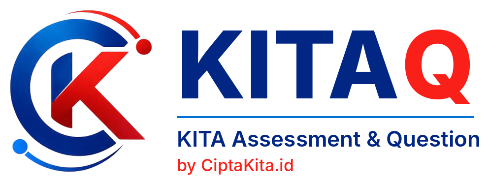
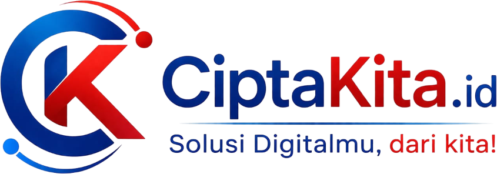

# Panduan Brand KITAQ ONLINE × CiptaKita.id

 &nbsp; 

## Identitas
- **Produk:** KITAQ ONLINE — *KITA Assessment & Question*, versi online dari KITAQ
- Penulisan: **KITAQ ONLINE** (keduanya kapital). Di logo, kata ONLINE berada di dalam pil merah KITAQ Red.
- **Perusahaan:** CiptaKita.id — *Solusi Digitalmu, dari kita!*
- Penulisan: **KITAQ** (huruf kapital semua), **CiptaKita.id** (C dan K kapital, `.id` huruf kecil).

## Warna

| Nama | HEX | RGB | Pemakaian |
|---|---|---|---|
| KITAQ Navy | `#022684` | 2, 38, 132 | Warna utama: header, tombol primer, teks judul |
| KITAQ Red | `#F92019` | 249, 32, 25 | Aksen: huruf "Q", peringatan, status terkunci, tombol bahaya |
| KITAQ Blue | `#0271D3` | 2, 113, 211 | Pendukung: link, garis aksen, info, progres |
| Ink | `#0F172A` | 15, 23, 42 | Teks isi |
| Paper | `#FFFFFF` | 255, 255, 255 | Latar |
| Mist | `#F1F5FB` | 241, 245, 251 | Latar sekunder/kartu |

Status ujian (monitoring): Hijau `#16A34A` mengerjakan · Kuning `#F59E0B` peringatan · Merah `#F92019` terkunci · Abu `#475569` terputus · Biru `#0271D3` selesai.

## Tipografi
- **Inter** (via `@fontsource/inter`, dibundel lokal — jangan Google Fonts CDN).
- Judul: Inter ExtraBold/Bold · Isi: Inter Regular/Medium · Ukuran isi soal minimal 16px di HP.

## File logo

| File | Pakai untuk |
|---|---|
| `kitaq-online-logo.png` | **Logo utama KITAQ ONLINE** untuk latar terang (login, admin terang, dokumen) |
| `kitaq-online-logo-dark.png` | KITAQ ONLINE untuk latar navy/gelap |
| `kitaq-logo.png` | Logo KITAQ (keluarga produk) di latar putih/terang (login, panel admin mode terang, dokumen) |
| `kitaq-logo-dark.png` | Latar navy/gelap (panel admin mode gelap, splash) |
| `ciptakita-mark.png` | Simbol CK saja: ikon, loading, favicon |
| `ciptakita-logo.png` | Logo perusahaan lengkap (halaman Tentang, footer besar, materi promosi) |
| `ciptakita-logo-white-bg.jpg` | Versi latar putih untuk dokumen/cetak |

## Aturan
- Beri ruang kosong di sekitar logo minimal setinggi huruf "K".
- Jangan mengubah warna, merenggangkan (stretch), memutar, atau memberi efek bayangan pada logo.
- Ukuran minimum logo KITAQ di layar: lebar 120px.
- Di dokumen milik sekolah (kartu ujian, berita acara), **logo sekolah yang utama**; KITAQ/CiptaKita.id cukup di footer kecil.
- Footer standar: `KITAQ v1.0 · © 2026 CiptaKita.id — Solusi Digitalmu, dari kita!`
